# financeBI

**A microservices finance application, deployed on Kubernetes on AWS with a fully automated CI/CD pipeline.**

financeBI is a personal-finance web app made up of four services: a home portal, a **home-loan EMI calculator**, a **SIP (mutual fund) calculator** and a **loan application form** backed by MySQL. The infrastructure is provisioned with **Terraform**, servers are configured with **Ansible**, every push to GitHub triggers a **Jenkins** pipeline that builds Docker images, publishes them to **Docker Hub** and rolls them out to a self-managed **Kubernetes** cluster on **AWS EC2**, and the cluster is observed with **Prometheus** and **Grafana** (installed with Helm).

<p align="center">
  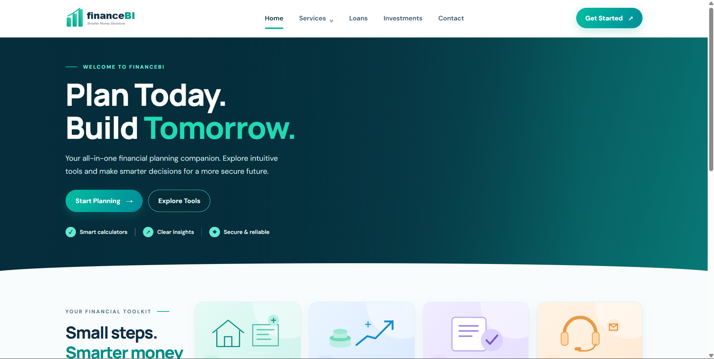
</p>

---

## Table of contents

1. [Highlights](#highlights)
2. [Architecture](#architecture)
3. [Tech stack](#tech-stack)
4. [Repository structure](#repository-structure)
5. [Application services](#application-services)
6. [Infrastructure as code](#infrastructure-as-code)
7. [Kubernetes deployment](#kubernetes-deployment)
8. [CI/CD with Jenkins](#cicd-with-jenkins)
9. [Monitoring with Prometheus and Grafana](#monitoring-with-prometheus-and-grafana)
10. [Deploy it yourself](#deploy-it-yourself)
11. [Run locally with Docker Compose](#run-locally-with-docker-compose)
12. [Application preview](#application-preview)
13. [Troubleshooting log](#troubleshooting-log)
14. [Security notes and known limitations](#security-notes-and-known-limitations)
15. [Future improvements](#future-improvements)

---

## Highlights

- **Infrastructure as code.** Terraform creates the VPC, public subnets, internet gateway, route table, security groups and EC2 instances. Ansible then prepares the Jenkins server and the Kubernetes nodes, so the environment can be rebuilt from code.
- **Self-managed Kubernetes.** A kubeadm cluster with one control-plane node and two workers, using CRI-O as the container runtime and Calico for pod networking.
- **8 Jenkins pipelines**, one per deployable component (frontends, backends and the database). Each one runs *clone → build → push → rolling update*.
- **Versioned images.** Every build is pushed to Docker Hub as `<service>-<build number>`, so any release can be traced and rolled back to.
- **Rolling updates verified in the pipeline.** Each deploy ends with `kubectl rollout status`, so a release that does not become healthy fails the build instead of passing silently.
- **Path-based routing** with the NGINX Ingress Controller: one hostname, four applications.
- **Observability.** Prometheus, Alertmanager and Grafana (kube-prometheus-stack) collect node and cluster metrics from all three nodes.

---

## Architecture

### Delivery flow

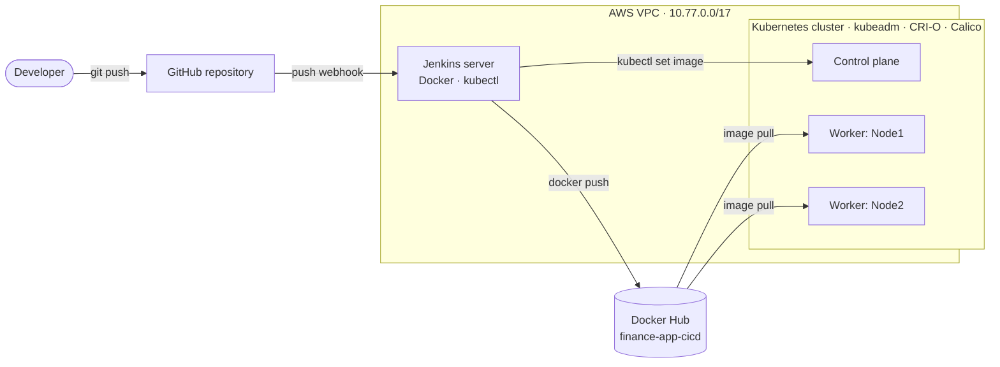

### Request flow

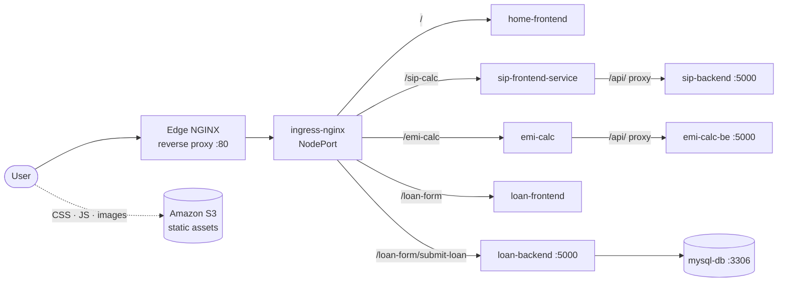

**How a request travels**

1. A reverse proxy on a cluster node forwards port 80 traffic to the **NodePort of the ingress-nginx controller**. The services are of type `LoadBalancer`, but a kubeadm cluster has no cloud load balancer controller, so their external IP stays `<pending>` and they are reached through NodePorts.
2. The **Ingress** routes by path: `/` to the home site, `/sip-calc`, `/emi-calc` and `/loan-form` to their frontends, and `/loan-form/submit-loan` straight to the loan backend.
3. The SIP and EMI frontends are NGINX containers that **reverse-proxy `/api/` to their backend service** inside the cluster. The backends are `ClusterIP` services and are never exposed publicly.
4. The loan backend writes applications to **MySQL**.
5. CSS, JavaScript and images are loaded by the browser from an **S3 bucket**, not from the containers. Changing a style or image means uploading `Assets/` to the bucket (see [Troubleshooting log](#troubleshooting-log)).

> The public hostname configured in the Ingress and in the navigation links is currently `www.bluevault.live`, a leftover from the project's original name. It is a single `host:` value in `k8s/ingress/bluevault-ingress.yaml`.

---

## Tech stack

| Area | Tools | Used for |
|---|---|---|
| Cloud | AWS EC2, VPC, S3 | Compute, networking, static assets |
| Infrastructure as code | Terraform | VPC, subnets, route table, security groups, EC2 instances |
| Configuration management | Ansible | Jenkins server and Kubernetes node setup |
| CI/CD | Jenkins, GitHub webhooks | Build, publish and deploy pipelines |
| Containers | Docker, Docker Hub | Image builds and registry |
| Orchestration | Kubernetes v1.32 (kubeadm), CRI-O, Calico | Cluster, runtime, pod networking |
| Routing | NGINX Ingress Controller v1.9.4, NGINX | Path-based routing and frontend-to-backend proxying |
| Monitoring | Helm, Prometheus, Alertmanager, Grafana, node-exporter | Metrics, dashboards, alerting |
| Application | HTML, CSS, JavaScript, Chart.js | Frontends |
| Application | Python (Flask), MySQL 8 | Backends and database |

---

## Repository structure

```text
.
├── App Code/
│   ├── home/                 # Landing page (NGINX serving static files)
│   ├── emi/
│   │   ├── frontend/         # EMI calculator UI + NGINX reverse proxy config
│   │   └── backend/          # Flask API
│   ├── sip/
│   │   ├── frontend/         # SIP calculator UI + NGINX reverse proxy config
│   │   └── backend/          # Flask API
│   └── loan/
│       ├── frontend/         # Loan form UI
│       ├── backend/          # Flask API, writes to MySQL
│       └── mysql/            # MySQL image with schema init script
├── Assets/                   # CSS, JS, images and logos (uploaded to S3)
├── k8s/                      # Kubernetes manifests (home, emi, sip, loan, ingress)
├── infrastructure/
│   ├── terraform/main.tf     # AWS networking and EC2 instances
│   └── ansible/              # Jenkins and Kubernetes node playbooks
├── jenkins/pipelines/        # The 8 pipeline scripts (Groovy)
└── docs/screenshots/         # Images used in this README
```

---

## Application services

| Service | Frontend | Backend | Public path | NodePort |
|---|---|---|---|---|
| Home portal | `home-frontend` (NGINX, static) | none | `/` | 30081 |
| SIP calculator | `sip-fe` | `sip-be` (Flask, `POST /api/calculate`) | `/sip-calc` | 30082 |
| EMI calculator | `emi-frontend-deployment` | `emi-backend-deployment` (Flask, `POST /api/calculate`) | `/emi-calc` | 30083 |
| Loan application | `loan-form-fe` | `loan-form-be` (Flask, `POST /submit-loan`, `GET /health`) | `/loan-form` | 30084 |
| Loan database | none | `loan-form-db` (MySQL 8) | internal only | n/a |

**What each service does**

- **EMI calculator** computes the monthly instalment, total amount payable and total interest for a loan amount, interest rate and tenure, and shows the principal versus interest split in a chart.
- **SIP calculator** projects the future value of a monthly mutual-fund investment, showing total invested, estimated returns and total value.
- **Loan application** validates and stores an applicant's name, contact number, UID, loan type and employment type in MySQL (`loan_applications` table).

---

## Infrastructure as code

Everything below lives in `infrastructure/`.

### Terraform: AWS foundation

`infrastructure/terraform/main.tf` provisions:

| Resource | Details |
|---|---|
| VPC | `10.77.0.0/17` with DNS support and DNS hostnames enabled |
| Internet gateway and route table | Default route `0.0.0.0/0` to the gateway, associated with all subnets |
| Subnets | Three public `/24` subnets (`10.77.0.0/24`, `10.77.1.0/24`, `10.77.2.0/24`) |
| Security groups | `jenkins-sg`, `k8s-cp-sg`, `k8s-nodes-sg` (ports below) |
| EC2 instances | Jenkins server, Kubernetes control plane, worker node(s), each from its own AMI and subnet |
| Bootstrap (`user_data`) | Creates an `ansible` user with passwordless sudo and enables SSH password authentication so Ansible can connect on first boot |

**Security group ports**

| Group | Ports |
|---|---|
| `jenkins-sg` | 22 (SSH), 8080 (Jenkins UI) |
| `k8s-cp-sg` | 22, 6443 (API server), 2379-2380 (etcd), 10250 (kubelet), 10257 (controller-manager), 10259 (scheduler), Calico (179, 4789, IP-in-IP), 53/udp (DNS) |
| `k8s-nodes-sg` | 22, 10250, 30000-32767 (NodePorts), Calico (179, 4789, IP-in-IP), 53/udp |

```bash
cd infrastructure/terraform
terraform init
terraform plan
terraform apply
```

Before applying, set the region, AMI IDs, instance types and key pair name to match your account. They are hard-coded in the file. See [Security notes](#security-notes-and-known-limitations) for hardening the security groups and replacing the bootstrap password.

### Ansible: server configuration

Two playbooks in `infrastructure/ansible/`, run against inventory groups `jenkins_servers` and `k8s_nodes`.

| Playbook | Target | What it does |
|---|---|---|
| `jenkins-playbook.yml` | `jenkins_servers` (RPM-based Linux) | Mounts a 2 GB tmpfs on `/tmp`, updates packages, installs Java 21 (Amazon Corretto), adds the Jenkins repository and key, installs and starts Jenkins, installs Docker and Git, adds the `jenkins` user to the `docker` group, installs and verifies `kubectl` |
| `k8s-playbook.yml` | `k8s_nodes` (Ubuntu) | Disables swap (now and in `/etc/fstab`), loads `overlay` and `br_netfilter`, sets the Kubernetes sysctl parameters, adds the Kubernetes and CRI-O v1.32 apt repositories, installs `cri-o`, `kubelet`, `kubeadm` and `kubectl`, pins their versions, and starts CRI-O |

Example inventory (adapt the addresses and user; this file is not committed):

```ini
[jenkins_servers]
jenkins ansible_host=<JENKINS_PUBLIC_IP>

[k8s_nodes]
control-plane ansible_host=<CP_PUBLIC_IP>
node1         ansible_host=<NODE1_PUBLIC_IP>
node2         ansible_host=<NODE2_PUBLIC_IP>

[all:vars]
ansible_user=ansible
```

```bash
ansible-galaxy collection install community.general
ansible-playbook -i inventory.ini infrastructure/ansible/jenkins-playbook.yml --ask-pass
ansible-playbook -i inventory.ini infrastructure/ansible/k8s-playbook.yml     --ask-pass
```

The playbooks prepare the machines but do **not** create the cluster. `kubeadm init`, installing the Calico CNI and `kubeadm join` are done by hand (see [Deploy it yourself](#deploy-it-yourself)).

<p align="center">
  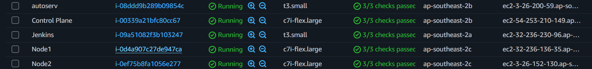<br>
  <em>EC2 instances: Jenkins server, control plane and worker nodes.</em>
</p>

---

## Kubernetes deployment

Manifests live in `k8s/`, one folder per service. Each file defines a Deployment and a Service.

<p align="center">
  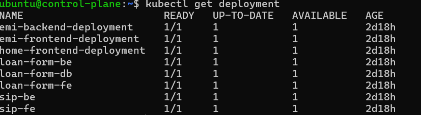<br>
  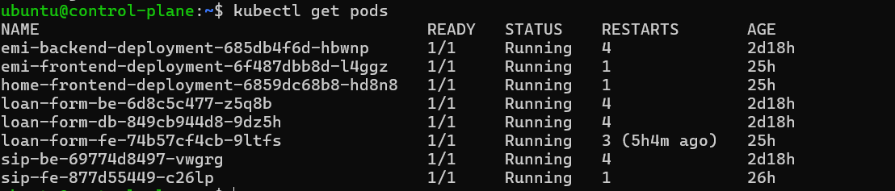<br>
  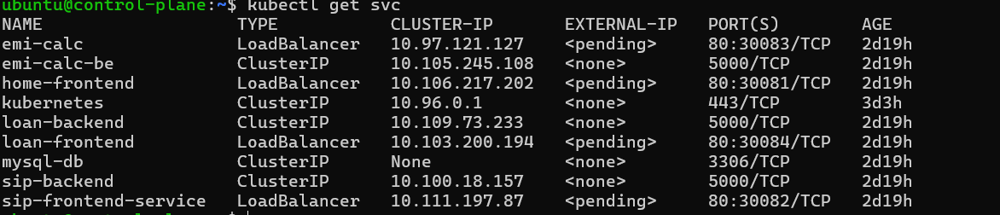<br>
  <em>All 8 deployments available, all pods running, services exposed on NodePorts 30081-30084.</em>
</p>

### Workloads

| Deployment | Replicas | CPU request / limit | Memory request / limit | Health probes |
|---|---|---|---|---|
| `home-frontend-deployment` | 1 | 50m / 100m | 64Mi / 128Mi | none |
| `emi-frontend-deployment` | 1 | 100m / 200m | 64Mi / 128Mi | none |
| `emi-backend-deployment` | 1 | 100m / 200m | 64Mi / 128Mi | none |
| `sip-fe` | 1 | not set | not set | none |
| `sip-be` | 1 | 100m / 200m | 64Mi / 128Mi | none |
| `loan-form-fe` | 1 | 50m / 200m | 64Mi / 256Mi | none |
| `loan-form-be` | 1 | 100m / 500m | 128Mi / 512Mi | liveness and readiness on `GET /health` |
| `loan-form-db` | 1 | not set | not set | liveness and readiness on TCP 3306 |

### Services and ingress

- Frontends are `LoadBalancer` services pinned to NodePorts 30081-30084 (reached via NodePort on this cluster, see [Architecture](#architecture)).
- Backends are `ClusterIP`; MySQL is a headless service (`mysql-db`) reachable only inside the cluster.
- `k8s/ingress/bluevault-ingress.yaml` defines the path rules for the NGINX Ingress Controller (`ingressClassName: nginx`) with a rewrite so each app sees requests relative to its own root.
- Backend connection settings (MySQL host, user, database) are passed to the loan backend as **environment variables** in the Deployment spec.

### Rolling updates

Deployments use the Kubernetes default `RollingUpdate` strategy (25% max surge, 25% max unavailable). With a single replica, that means Kubernetes starts the new pod first and removes the old one only after the new one is ready. For the loan backend, "ready" means the `/health` check passes; for services without a readiness probe it means the container has started.

Verify and roll back a release:

```bash
kubectl rollout status deployment/<deployment-name>
kubectl rollout history deployment/<deployment-name>
kubectl rollout undo deployment/<deployment-name>                  # previous revision
kubectl rollout undo deployment/<deployment-name> --to-revision=N  # specific revision
```

---

## CI/CD with Jenkins

Eight pipeline jobs, one per deployable component. The scripts are in `jenkins/pipelines/` and share the same four stages. Only the per-module variables at the top change.

| Jenkins job | Module path | Image tag prefix | Kubernetes deployment |
|---|---|---|---|
| `home-page` | `App Code/home` | `home-frontend` | `home-frontend-deployment` |
| `emi-calculator-frontend` | `App Code/emi/frontend` | `emi-calc-frontend` | `emi-frontend-deployment` |
| `emi-calculator-backend` | `App Code/emi/backend` | `emi-backend` | `emi-backend-deployment` |
| `sip-frontend` | `App Code/sip/frontend` | `sip-frontend` | `sip-fe` |
| `sip-backend` | `App Code/sip/backend` | `sip-backend` | `sip-be` |
| `loan-frontend` | `App Code/loan/frontend` | `frontend` | `loan-form-fe` |
| `loan-backend` | `App Code/loan/backend` | `loan-backend` | `loan-form-be` |
| `loan-db` | `App Code/loan/mysql` | `mysql` | `loan-form-db` |

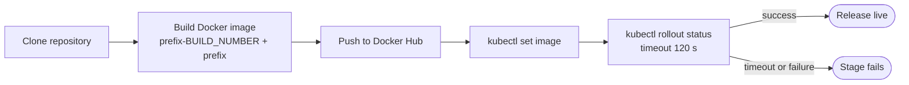

**Stages**

1. **Clone Repository.** Checks out the `master` branch of the project repository.
2. **Build Docker Image.** Builds from the module's folder and tags the image twice: `<prefix>-<build number>` (immutable, used for the deploy) and `<prefix>` (moving "latest for this service" tag).
3. **Push Docker Image.** Logs in to Docker Hub with the Jenkins credential `dockerhub` and pushes both tags to `finance-app-cicd`.
4. **Rolling Update Kubernetes Deployment.** Runs `kubectl set image` with the new build-number tag, then `kubectl rollout status --timeout=120s`. If the new pods do not become ready in time, the stage fails and the build is marked red.

**Trigger.** A GitHub webhook (`/github-webhook/`, JSON payload, push events) starts the jobs through "GitHub hook trigger for GITScm polling".

**Access.** Jenkins runs Docker builds as the `jenkins` user (member of the `docker` group) and talks to the cluster with a kubeconfig stored for that user.

<p align="center">
  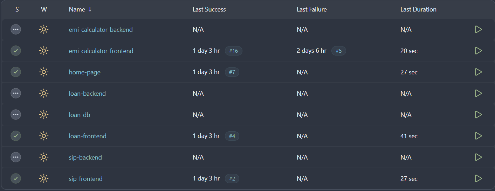<br>
  <em>The eight pipeline jobs on the Jenkins dashboard. The backend and database jobs are defined identically but had not been run when this screenshot was taken.</em>
</p>

<p align="center">
  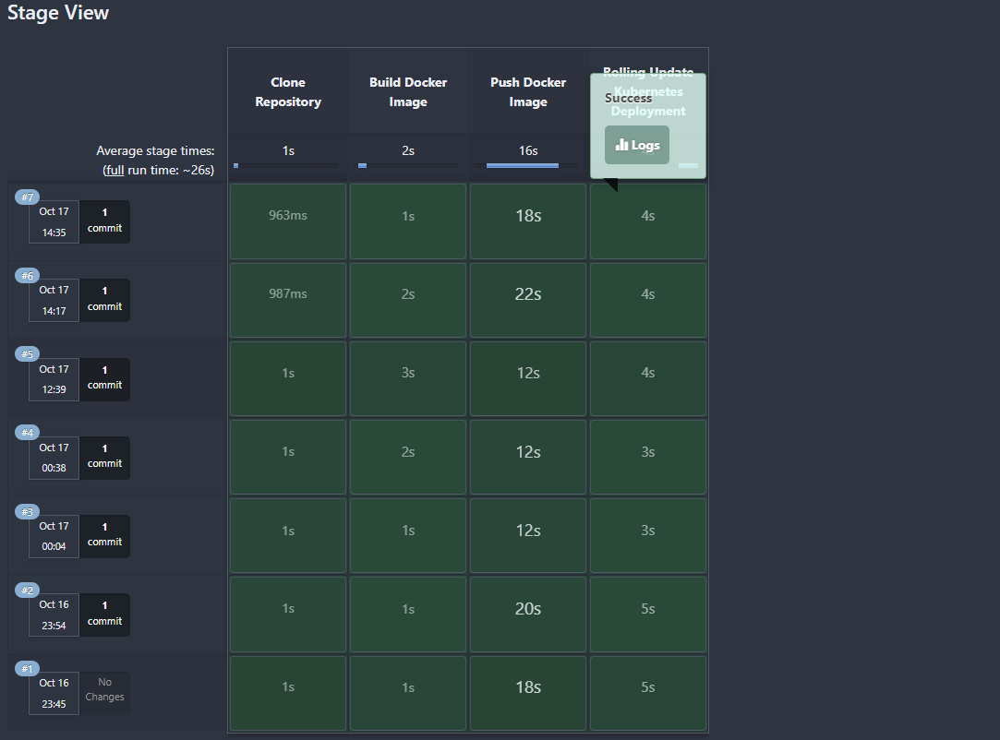
  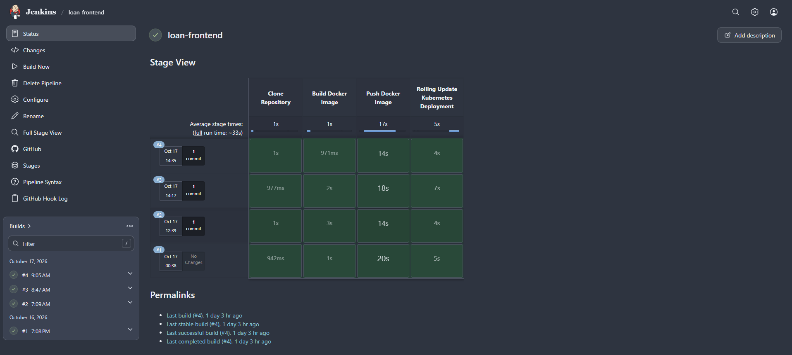<br>
  <em>Stage view of the <code>home-page</code> and <code>loan-frontend</code> pipelines. A full run takes about 26 to 33 seconds, with the Docker Hub push as the longest stage.</em>
</p>

<p align="center">
  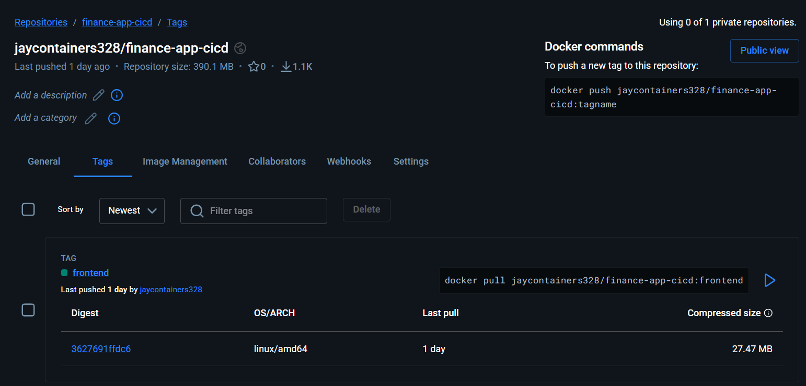<br>
  <em>Images published to the <code>jaycontainers328/finance-app-cicd</code> Docker Hub repository.</em>
</p>

---

## Monitoring with Prometheus and Grafana

The monitoring stack is installed with Helm using the **kube-prometheus-stack** chart. It deploys Prometheus, Alertmanager, Grafana, kube-state-metrics and a **node-exporter on every node**.

```bash
helm repo add prometheus-community https://prometheus-community.github.io/helm-charts
helm repo update
helm install monitoring prometheus-community/kube-prometheus-stack \
  -n monitoring --create-namespace

# Grafana admin password
kubectl get secret -n monitoring monitoring-grafana \
  -o jsonpath="{.data.admin-password}" | base64 -d

# Access (use a NodePort or ingress for anything long-lived)
kubectl port-forward -n monitoring svc/monitoring-grafana 3000:80 --address 0.0.0.0
```

Prometheus scrapes node-exporter on port **9100** of each node, so the node security groups must allow that traffic between nodes (see [Troubleshooting log](#troubleshooting-log)).

<p align="center">
  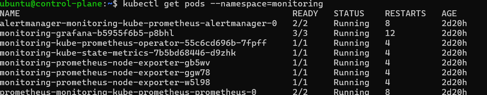<br>
  <em>The monitoring stack running in the <code>monitoring</code> namespace, including one node-exporter per node.</em>
</p>

**Dashboards.** The *Node Exporter / Nodes* dashboard shows CPU, load, memory, disk and network for each machine. Use the **Instance** dropdown to switch nodes.

| Node | Instance | Screenshot |
|---|---|---|
| Control plane | `10.77.1.237:9100` | [grafana-control-plane.png](docs/screenshots/grafana-control-plane.png) |
| Node1 | `10.77.2.148:9100` | [grafana-node1.png](docs/screenshots/grafana-node1.png) |
| Node2 | `10.77.2.120:9100` | [grafana-node2.png](docs/screenshots/grafana-node2.png) |

<p align="center">
  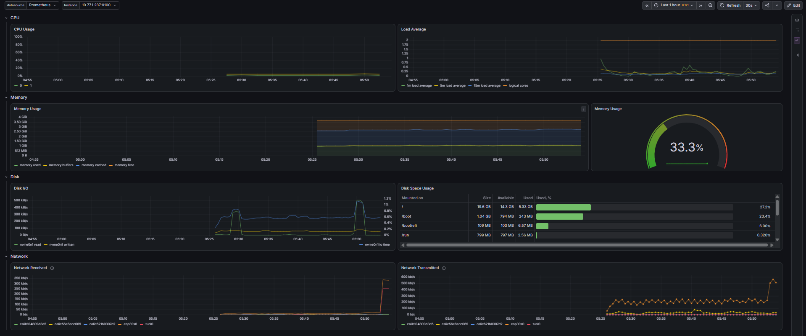<br>
  <em>Grafana, control-plane node.</em>
</p>

<details>
<summary>Grafana dashboards for the worker nodes</summary>

<p align="center">
  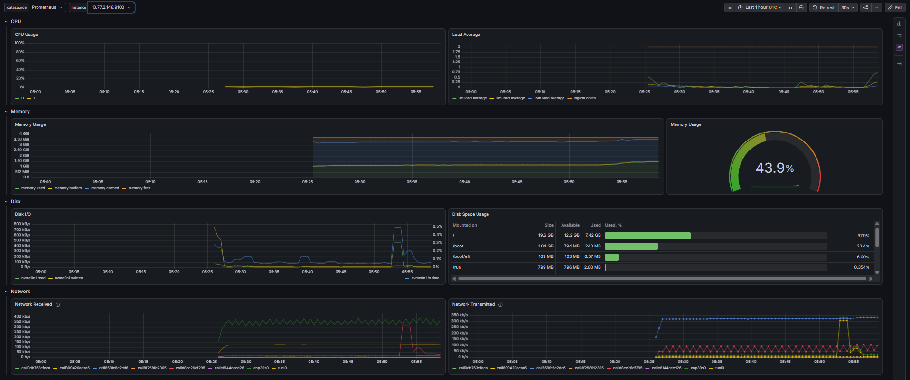<br>
  <em>Node1</em><br><br>
  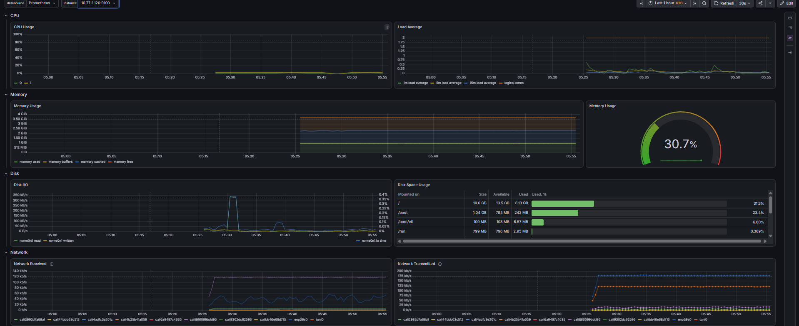<br>
  <em>Node2</em>
</p>

</details>

---

## Deploy it yourself

**Prerequisites:** an AWS account and EC2 key pair, Terraform, Ansible (with the `community.general` collection), a Docker Hub account, and a GitHub repository for the code.

1. **Provision AWS resources.**
   ```bash
   cd infrastructure/terraform && terraform init && terraform apply
   ```
2. **Configure the servers.** Create an inventory (see [Ansible](#ansible-server-configuration)) and run both playbooks.
3. **Create the Kubernetes cluster** on the control-plane node. These steps are manual:
   ```bash
   sudo kubeadm init --pod-network-cidr=<POD_CIDR> --apiserver-advertise-address=<CP_PRIVATE_IP>
   mkdir -p $HOME/.kube && sudo cp /etc/kubernetes/admin.conf $HOME/.kube/config
   sudo chown $(id -u):$(id -g) $HOME/.kube/config
   kubectl apply -f <calico-manifest>      # CNI; POD_CIDR must match the Calico configuration
   ```
   Then run the `kubeadm join ...` command printed by `kubeadm init` on each worker node and confirm with `kubectl get nodes`.
4. **Install the ingress controller and routes.**
   ```bash
   kubectl apply -f https://raw.githubusercontent.com/kubernetes/ingress-nginx/controller-v1.9.4/deploy/static/provider/cloud/deploy.yaml
   kubectl get svc -n ingress-nginx          # note the controller's NodePort
   kubectl apply -f k8s/ingress/bluevault-ingress.yaml
   ```
5. **Add the edge reverse proxy** on a cluster node so port 80 reaches the ingress NodePort:
   ```nginx
   server {
       listen 80;
       server_name <YOUR_DOMAIN>;
       location / {
           proxy_pass http://localhost:<INGRESS_NODEPORT>;
           proxy_set_header Host $host;
           proxy_set_header X-Real-IP $remote_addr;
       }
   }
   ```
6. **Set up Jenkins** (`http://<jenkins-ip>:8080`):
   - Install the plugins *Git*, *Pipeline*, *Docker Pipeline* and *Kubernetes CLI*.
   - Add a **Username with password** credential with ID `dockerhub` (Docker Hub).
   - Copy the cluster kubeconfig to `/var/lib/jenkins/.kube/config` and `chown` it to `jenkins`.
   - Create one *Pipeline* job per file in `jenkins/pipelines/`, tick *GitHub hook trigger for GITScm polling*, and paste the script.
   - In GitHub: *Settings → Webhooks → Add webhook*, payload URL `http://<jenkins-ip>:8080/github-webhook/`, content type `application/json`, push events only.
7. **Deploy the application.** Apply the manifests once to create the Deployments (later releases come from Jenkins):
   ```bash
   kubectl apply -f k8s/loan/mysql.yml -f k8s/loan/be.yml -f k8s/loan/fe.yml
   kubectl apply -f k8s/emi/be.yml -f k8s/emi/fe.yml
   kubectl apply -f k8s/sip/be.yml -f k8s/sip/fe.yml
   kubectl apply -f k8s/home/fe.yml
   kubectl get pods
   ```
8. **Upload `Assets/` to the S3 bucket** that the HTML pages reference (the bucket and region are in the `<link>` and `` URLs of each page).
9. **Install monitoring** with the Helm commands in [Monitoring](#monitoring-with-prometheus-and-grafana).
10. **Ship a change.** Push a commit. The matching pipeline builds, pushes and rolls out the new image. Watch it with `kubectl rollout status deployment/<name>`.

---

## Run locally with Docker Compose

Each service folder has a `docker-compose.yml`. For example, the loan application with its backend and database:

```bash
cd "App Code/loan"
docker compose up --build
# open http://localhost
```

Use the same pattern in `App Code/home`, `App Code/emi` and `App Code/sip`. Compose binds port 80, so run one stack at a time.

---

## Application preview

<table>
  <tr>
    <td><br><em>Home</em></td>
    <td>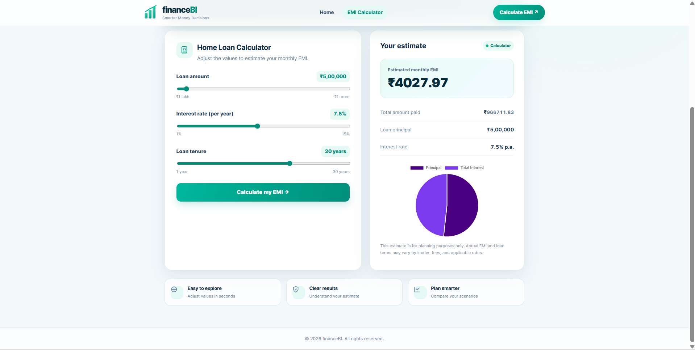<br><em>EMI calculator</em></td>
  </tr>
  <tr>
    <td>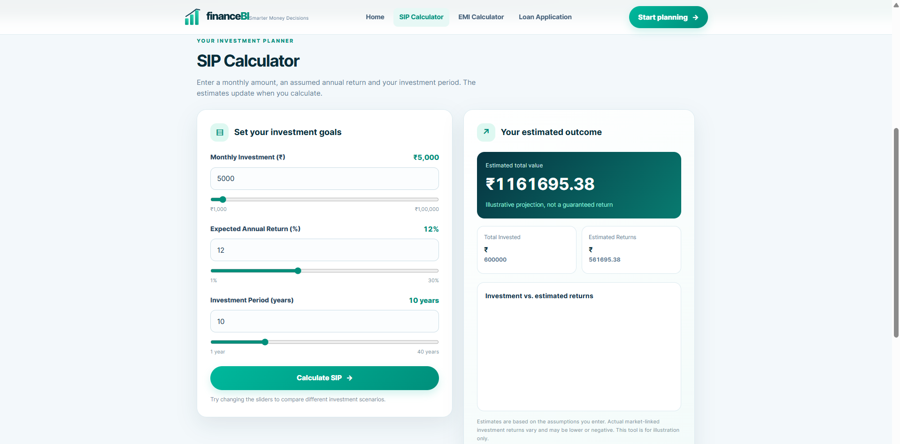<br><em>SIP calculator</em></td>
    <td>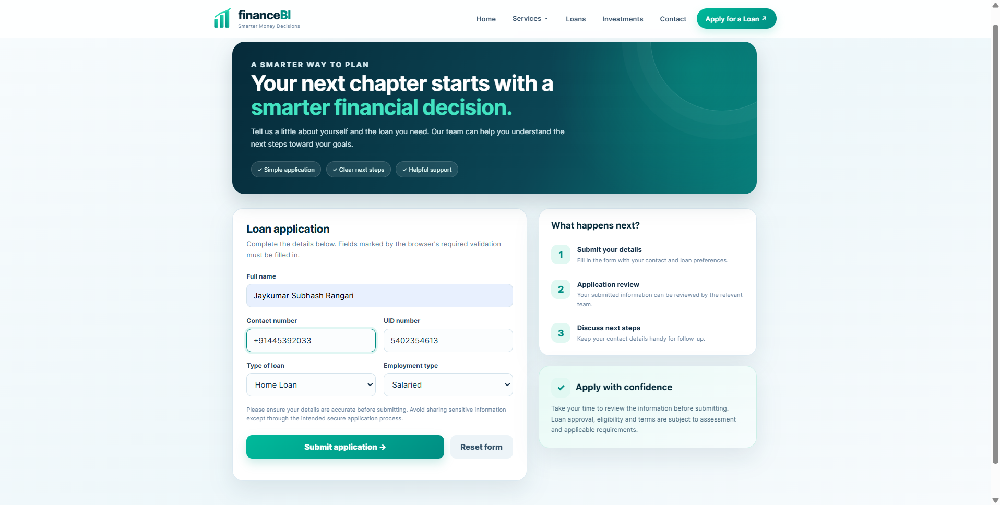<br><em>Loan application</em></td>
  </tr>
</table>

---

## Troubleshooting log

Real problems met while building and running this project, and how they were resolved.

| Symptom | Cause | Fix |
|---|---|---|
| Grafana's *Instance* dropdown listed only one node | Prometheus could reach node-exporter only on its own node; the AWS security groups blocked port 9100 between nodes | Allow TCP 9100 (and 10250 for kubelet metrics) between the cluster nodes' security groups. Verify under *Prometheus → Status → Targets* that all 3 node-exporter targets are `UP` |
| `kubectl top nodes` returns a Metrics API error | metrics-server is not installed (Grafana does not need it, because Prometheus collects the same data) | Install metrics-server; on a self-managed cluster it also needs the `--kubelet-insecure-tls` argument |
| Services of type `LoadBalancer` show `EXTERNAL-IP <pending>` | A kubeadm cluster has no cloud load-balancer controller | Reach services through their NodePort and the ingress controller, as described in [Architecture](#architecture) |
| A rollout does not complete and the Jenkins stage fails after 120 s | New pod cannot start or pass its readiness check (for example `ImagePullBackOff` or a failing `/health`) | `kubectl describe pod` and `kubectl logs` to find the cause, then `kubectl rollout undo deployment/<name>` to return to the previous revision |
| New CSS or images do not appear after a successful deploy | The pages load styles, scripts and images from S3, not from the container image | Upload the changed files under `Assets/` to the S3 bucket |

---

## Security notes and known limitations

This is a learning and portfolio project. These are known gaps, listed so they are not mistaken for production practice.

**Secrets**
- The MySQL password is written in plain text in the Kubernetes manifests, the MySQL Dockerfile and the Compose file, and the loan backend has it as a default value. The environment variables are set directly in the Deployment specs. There are no Kubernetes `Secret` or `ConfigMap` objects. Treat any credential committed to this repository as exposed: rotate it and move it into Kubernetes Secrets.
- The Terraform bootstrap script sets a fixed password for the `ansible` user and enables SSH password authentication. Replace it with SSH key authentication.

**Network**
- Every security group rule allows `0.0.0.0/0`, including SSH, the Kubernetes API, etcd and the kubelet. Restrict them to your own IP or the VPC CIDR.
- The site is served over plain HTTP.

**Data and availability**
- MySQL runs **without persistent storage** (the volume claim was removed from the manifest). Loan applications are lost if the database pod is rescheduled or restarted.
- Every Deployment runs a single replica, so a node failure causes downtime. Rolling updates keep the old pod until the new one is ready, but only the loan backend and MySQL define readiness probes.
- A failed rollout fails the Jenkins stage but is **not reverted automatically**. Run `kubectl rollout undo` manually.

**Application**
- The loan backend logs applicant details (name, contact and UID) at INFO level. Remove or mask them before handling real data.
- The deployed SIP page still has a front-end bug where the "Investment vs. estimated returns" chart does not render (a global variable collides with the canvas element's `id`). The numeric results are correct.

---

## Future improvements

- Move credentials to Kubernetes Secrets and configuration to ConfigMaps; back MySQL with a PersistentVolumeClaim (EBS CSI driver) or a managed database.
- Run at least two replicas of each service and add readiness probes everywhere, with a PodDisruptionBudget.
- Add automatic rollback to the pipelines (a `post { failure { kubectl rollout undo } }` block).
- Replace the eight near-identical scripts with one parameterized Jenkinsfile or a shared library, and add image cleanup and a vulnerability scan stage.
- Terraform: add remote state (S3 and DynamoDB locking), variables for region and instance types, the second worker node, and the 9100 and 10250 node-to-node rules.
- Install metrics-server and add Alertmanager receivers (Slack or email) with alert rules for node, pod and Jenkins health.
- Add TLS with cert-manager and Let's Encrypt, and an Ingress host that matches the financeBI brand.
- Add the Jenkins Prometheus plugin and a Grafana dashboard for pipeline health.
